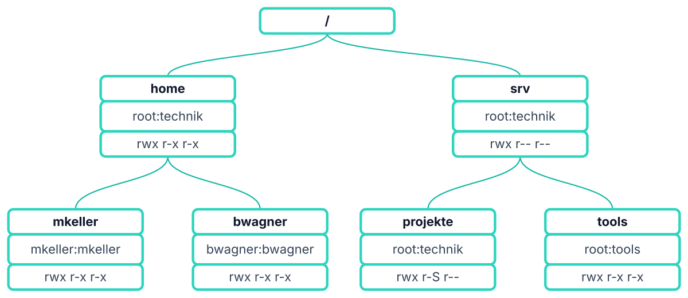
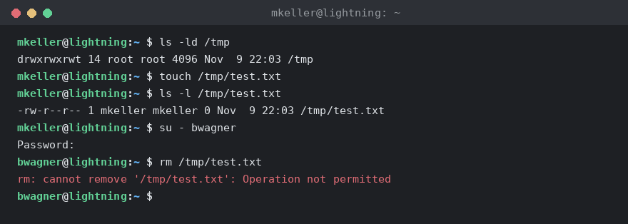

# Übung 3: Berechtigungen unter Linux (Klausurübung)

> LF7 – LS1 Einstieg Linuxsysteme · Klausurübung: Rechtesystem und Umsetzung
> Quelle: `LS7.1_Uebung_Rechte_Klausur.pdf`, `LS7.1_Rechte_Uebung_Musterloesung.pdf`, `LS7.1_TF3.x_Testumgebung_sdme.pdf`
> Ressourcen: `Ressources/baum_vorschau.png`, `Ressources/rechte_uebung_baum.drawio`, `Ressources/sticky-bit.png`, `Ressources/setup_rechte_uebung.sh`

**Inhalt**

- [Szenario](#szenario)
- [Teil A: Aufgaben](#teil-a-aufgaben)
- [Teil B: Musterlösung](#teil-b-musterlösung)
- [Nachbereitung: Testumgebung mit sdme](#nachbereitung-testumgebung-mit-sdme)
- [Setup-Skript](#setup-skript-ressourcessetup_rechte_uebungsh)

---

## Szenario

**`/etc/group` (relevante Zeilen):**

```text
sudo:x:27:zturner,hklaus,fweber,mkeller
technik:x:2010:mkeller,bwagner
tools:x:2011:bwagner
bwagner:x:2002:
mkeller:x:2001:
```

**Verzeichnisbaum** (Rechner `lightning`):



```text
/
├── home         root:technik     rwx r-x r-x  (755)
│   ├── mkeller  mkeller:mkeller  rwx r-x r-x  (755)
│   └── bwagner  bwagner:bwagner  rwx r-x r-x  (755)
└── srv          root:technik     rwx r-- r--  (754)
    ├── projekte root:technik     rwx r-S r--  (2754)
    └── tools    root:tools       rwx r-x r-x  (755)
```

**Wer ist in welcher Gruppe?**

| Benutzer | Primärgruppe     | weitere Gruppen        |
|----------|------------------|------------------------|
| mkeller  | mkeller (2001)   | technik, sudo          |
| bwagner  | bwagner (2002)   | technik, tools         |
| hklaus   | hklaus           | sudo                   |

> Wichtig: `/srv` gibt der Gruppe `technik` nur `r--` – also **kein `x`**. Wer über die Gruppe `technik` (oder als others) auf `/srv` zugreift, darf die Namen auflisten, aber nicht hindurchgehen.

---

# Teil A: Aufgaben

## Vorbereitung

Bevor es an die Multiple-Choice-Aufgaben geht, muss das Szenario erst hergestellt werden. Notiere jeweils den vollständigen Befehl (bzw. die Befehle), den du am Raspberry Pi eingeben würdest.

*Bepunktung: siehe Punktangabe je Aufgabe, kein Teilpunkt (nur bei vollständig korrektem Befehl je Teilschritt).*

### V1 (2 Punkte)

Richte die Gruppe `tools` mit der GID `2011` ein und nimm `bwagner` als Mitglied auf (siehe `/etc/group`-Auszug oben).

```text
mkeller@lightning:/home/mkeller $
```

> **Tipp (aus der man-Page):** `--gid GID` – When creating a group, this option sets the group ID number of the new group to GID. When creating a user, this option sets the primary group ID number of the new user to GID. (GID = numerische Gruppen-ID, z. B. 2011 – kein Gruppenname.) (Debian man-pages)

### V2 (4 Punkte)

Heiko Klaus (`hklaus`) wird neu eingestellt. Lege für ihn einen Benutzeraccount an (siehe `/etc/group`-Auszug oben).

```text
mkeller@lightning:/srv $
```

### V3 (10 Punkte)

`hklaus` legt anschließend das Verzeichnis `/srv/projekte` an und versieht es mit den im Diagramm abgebildeten Zugriffsrechten (Besitzer `root:technik`, Rechte `rwxr-Sr--`).

```text
hklaus@lightning:/home/hklaus $
```

## Aufgaben (Multiple Choice)

Entscheide für jeden Befehl, ob er funktioniert, und kreuze **Ja** oder **Nein** an. Bei Aufgabe 3 und 5b zusätzlich schriftlich begründen.

*Bepunktung: je Aufgabe 1 Punkt (richtig) / −1 Punkt (falsch), Teilsumme nicht negativ. Begründungen je 3 Punkte, kein Abzug bei falscher Begründung. Gesamt: 36 Punkte.*

| Nr | Prompt und Befehl                                      | Rolle   | Ja | Nein |
|----|--------------------------------------------------------|---------|----|------|
| 1  | `mkeller@lightning:/home $ cd srv`                     | mkeller |    |      |
| 2  | `mkeller@lightning:/home $ cd bwagner`                 | mkeller |    |      |
| 3  | `bwagner@lightning:/ $ cd /srv/projekte`               | bwagner |    |      |
| 4  | `bwagner@lightning:/home/mkeller $ cd ../../srv/tools` | bwagner |    |      |
| 5a | `bwagner@lightning:/ $ ls /srv`                        | bwagner |    |      |
| 5b | `bwagner@lightning:/ $ ls -l /srv`                     | bwagner |    |      |
| 6  | `bwagner@lightning:/srv/projekte $ touch neu.txt`      | bwagner |    |      |
| 7  | `mkeller@lightning:/srv/projekte $ sudo touch neu.txt` | mkeller |    |      |
| 8  | `mkeller@lightning:/srv $ cd ~`                        | mkeller |    |      |
| 9  | `bwagner@lightning:/ $ sudo cd /srv/projekte`          | bwagner |    |      |

**Begründung zu Aufgabe 3 (3 Punkte):** …

**Begründung zu Aufgabe 5b (3 Punkte):** …

## Zusatzaufgabe: Beobachten und Recherchieren

### Z1 (4 Punkte)

Analysiere den gegebenen Screenshot – fällt dir etwas bei den Zugriffsrechten auf? Überprüfe das Verhalten anschließend auf deinem eigenen Raspberry Pi und recherchiere, was dahintersteckt. Dokumentiere kurz deine Beobachtung und dein Recherche-Ergebnis (mit Quelle).



```text
mkeller@lightning:~ $ ls -ld /tmp
drwxrwxrwt 14 root root 4096 Nov  9 22:03 /tmp
mkeller@lightning:~ $ touch /tmp/test.txt
mkeller@lightning:~ $ ls -l /tmp/test.txt
-rw-r--r-- 1 mkeller mkeller 0 Nov  9 22:03 /tmp/test.txt
mkeller@lightning:~ $ su - bwagner
Password:
bwagner@lightning:~ $ rm /tmp/test.txt
rm: cannot remove '/tmp/test.txt': Operation not permitted
```

---

# Teil B: Musterlösung

## Vorbereitung

### V1 (2 Punkte)

```bash
sudo addgroup --gid 2011 tools
sudo adduser bwagner tools
```

> Die GID 2011 ist auf `/srv/tools` bereits numerisch vorbelegt. Sobald die Gruppe `tools` mit genau dieser GID existiert, zeigt `ls -l /srv` statt `2011` den Namen `tools` an.

### V2 (2 + 2 Punkte)

```bash
sudo adduser hklaus
sudo adduser hklaus sudo
```

> Laut `/etc/group` ist `hklaus` Mitglied der Gruppe `sudo` – das muss nach dem Anlegen zusätzlich erledigt werden.

### V3 (2 + 4 + 4 Punkte)

```bash
sudo mkdir /srv/projekte
sudo chown root:technik /srv/projekte
sudo chmod 2754 /srv/projekte
```

> ⚠️ **Hinweis zur Musterlösung:** Ein großes `S` bedeutet „SGID gesetzt, aber **kein** `x` für die Gruppe". `rwxr-Sr--` entspricht daher oktal `2744` (Gruppe `r--` = 4, plus SGID). Mit dem in der Musterlösung angegebenen `chmod 2754` hätte die Gruppe `r-x`, und `ls -l` würde `rwxr-sr--` (kleines `s`) anzeigen. Für exakt das Diagramm wäre also `sudo chmod 2744 /srv/projekte` richtig. Für die Multiple-Choice-Aufgaben spielt das keine Rolle, weil dort schon `/srv` den Zugriff blockiert.

## Aufgaben (Multiple Choice)

| Nr | Prompt und Befehl                                      | Rolle   | Ergebnis | Punkte |
|----|--------------------------------------------------------|---------|----------|--------|
| 1  | `mkeller@lightning:/home $ cd srv`                     | mkeller | **Nein** | 1      |
| 2  | `mkeller@lightning:/home $ cd bwagner`                 | mkeller | **Ja**   | 1      |
| 3  | `bwagner@lightning:/ $ cd /srv/projekte`               | bwagner | **Nein** | 1 + 3  |
| 4  | `bwagner@lightning:/home/mkeller $ cd ../../srv/tools` | bwagner | **Nein** | 1      |
| 5a | `bwagner@lightning:/ $ ls /srv`                        | bwagner | **Ja**   | 1      |
| 5b | `bwagner@lightning:/ $ ls -l /srv`                     | bwagner | **Nein** | 1 + 3  |
| 6  | `bwagner@lightning:/srv/projekte $ touch neu.txt`      | bwagner | **Nein** | 1      |
| 7  | `mkeller@lightning:/srv/projekte $ sudo touch neu.txt` | mkeller | **Ja**   | 1      |
| 8  | `mkeller@lightning:/srv $ cd ~`                        | mkeller | **Ja**   | 1      |
| 9  | `bwagner@lightning:/ $ sudo cd /srv/projekte`          | bwagner | **Nein** | 1      |

**Begründung zu Aufgabe 3:**
`/srv` ist für die Gruppe `technik` nur `r--` → kein `x`. Der Befehl scheitert schon beim Durchqueren von `/srv`, nicht erst am Ziel `/srv/projekte`.

**Begründung zu Aufgabe 5b:**
`ls -l` braucht zusätzlich das Ausführungsrecht auf `/srv`, um die Metadaten der Einträge zu lesen – das fehlt (nur `r--`). Unterschied zu 5a: reines Auflisten der Namen vs. Zugriff auf Dateiattribute.

### Kurze Erklärungen zu den übrigen Aufgaben

| Nr | Erklärung |
|----|-----------|
| 1  | In `/home` gibt es kein Verzeichnis `srv` (relativer Pfad!). Richtig wäre `cd /srv` bzw. `cd ../srv`. |
| 2  | `/home/bwagner` hat `rwxr-xr-x` – others haben `x`, also darf mkeller hineinwechseln. |
| 4  | Der Pfad führt über `/srv`; dort fehlt bwagner (Gruppe `technik`) das `x`. Dass bwagner in `tools` ist, hilft nicht, weil der Weg schon vorher versperrt ist. |
| 6  | Gleiches Problem: Um nach `/srv/projekte` zu gelangen bzw. dort anzulegen, braucht man `x` auf `/srv` und `w`+`x` auf `projekte` – beides fehlt. |
| 7  | mkeller ist in der Gruppe `sudo`; mit `sudo` läuft `touch` als root, root ignoriert die Rechte. |
| 8  | `cd ~` wechselt ins eigene Home `/home/mkeller` – dort hat mkeller als Besitzer `rwx`. |
| 9  | bwagner ist **nicht** in der Gruppe `sudo`. Außerdem ist `cd` ein Shell-Builtin und kann gar nicht über `sudo` ausgeführt werden. |

## Zusatzaufgabe Z1

**Beobachtung:** Bei `/tmp` steht `rwxrwxrwt` – an der Stelle, an der bei „andere" sonst `x` oder `-` steht, erscheint ein `t`. `/tmp` ist augenscheinlich für alle offen (jeder darf dort Dateien anlegen), trotzdem kann `bwagner` die Datei `test.txt` von `mkeller` nicht löschen (`Operation not permitted`).

**Erklärung:** Das zusätzliche `t` am Ende der Rechte ist das **Sticky-Bit**. In einem Verzeichnis mit gesetztem Sticky-Bit darf zwar jede:r Dateien anlegen, aber nur der Eigentümer der jeweiligen Datei (bzw. root bzw. der Verzeichnis-Eigentümer) darf sie löschen oder umbenennen – genau das Verhalten, das ein von allen gemeinsam genutztes Verzeichnis wie `/tmp` braucht, damit niemand fremde Dateien einfach entfernen kann.

**Setzen:**

```bash
chmod +t <verzeichnis>
chmod 1777 <verzeichnis>   # führende 1 vor den klassischen drei Rechte-Ziffern
```

**Quelle:** `man chmod` (Abschnitt „sticky bit"), z. B. <https://man7.org/linux/man-pages/man1/chmod.1.html>

### Übersicht Spezialbits

| Bit       | Oktal | Anzeige                 | Wirkung auf Verzeichnis                                   |
|-----------|-------|-------------------------|-----------------------------------------------------------|
| SUID      | 4     | `s`/`S` beim Besitzer   | (bei Dateien: läuft mit Rechten des Besitzers)            |
| SGID      | 2     | `s`/`S` bei der Gruppe  | neue Einträge erben die Gruppe des Verzeichnisses         |
| Sticky    | 1     | `t`/`T` bei others      | nur Eigentümer darf eigene Dateien löschen/umbenennen     |

Kleinbuchstabe = darunter ist `x` gesetzt, Großbuchstabe = kein `x`.

---

## Nachbereitung: Testumgebung mit sdme

Nach der Klausurübung kannst du die Übung in Ruhe noch einmal komplett selbst nachbauen – ohne Punktedruck, aber auch ohne Schablone: Du legst das gesamte Szenario (Gruppen, Nutzer, Verzeichnisse) eigenständig an und arbeitest anschließend die Vorbereitungs- und Multiple-Choice-Aufgaben erneut durch.

Dafür kommt **sdme** zum Einsatz: ein leichtgewichtiges Container-Werkzeug, ähnlich wie Docker, nur auf Basis von `systemd-nspawn`. `systemd-nspawn` ist ein Werkzeug des systemd-Pakets, das verwendet wird, um Befehle oder komplette Betriebssysteme in einem leichtgewichtigen Namespace-Container auszuführen. Es funktioniert ähnlich wie `chroot`, ist jedoch leistungsfähiger, da es die Dateisystemhierarchie, den Prozessbaum sowie Host- und Domain-Namen virtualisiert, ohne einen Hypervisor zu benötigen. Es startet also einen eigenen, isolierten Linux-Container (Linux-Namespaces + cgroups) auf deinem Raspberry Pi, in dem du frei experimentieren kannst, ohne dein reales System zu verändern.

**Voraussetzung:** 64-Bit Raspberry Pi OS (Trixie) muss installiert sein.

1. **systemd-container installieren**
   ```bash
   sudo apt install systemd-container
   ```
2. **sdme installieren (aarch64-Binary)**
   ```bash
   curl -fsSL https://sdme.io/install.sh | sudo sh
   ```
3. **Neuen Container starten**
   ```bash
   sudo sdme new --name lightning
   ```
4. **Container beenden**
   ```bash
   exit
   ```

   Der Containername `lightning` ist bewusst gewählt: Er entspricht genau dem Hostnamen, der in der Übung in den Prompts verwendet wird (z. B. `mkeller@lightning:~ $`). Was du im Container machst, bleibt im Container.

5. **Das Ausgangsszenario komplett selbst nachbauen**

   Es gibt diesmal kein Setup-Skript. Nimm das Diagramm und den `/etc/group`-Auszug als Zielzustand und baue ihn im Container von Grund auf selbst nach – inklusive der Schritte, die in der Klausur schon vorgegeben waren. Dazu gehören mindestens:
   - Gruppe `technik` (GID 2010)
   - Nutzer `mkeller` mit eigener Gruppe (GID 2001), Mitglied in `technik` und `sudo`
   - Nutzer `bwagner` mit eigener Gruppe (GID 2002), Mitglied in `technik`, **nicht** in `sudo`
   - `/home` mit Gruppe `technik`, `rwxr-xr-x`
   - `/srv` mit Eigentümer `root:technik`, `rwxr--r--`
   - `/srv/tools`, Eigentümer `root`, Gruppe numerisch auf GID 2011 gesetzt (die Gruppe „tools" selbst gibt es absichtlich noch nicht)

6. **Vorbereitung und Aufgaben erneut durcharbeiten**

   Sobald der Container dem Szenario entspricht, kannst du V1–V3 sowie alle Befehle aus der Aufgaben-Tabelle real ausprobieren und mit deinen damaligen Antworten vergleichen.

7. **Container zurücksetzen**

   Ein Container ist ein Wegwerf-System: Verlässt du ihn mit `exit` und löschst ihn wieder, verschwinden alle Änderungen spurlos. Starte für einen neuen Versuch einfach wieder mit Schritt 3 – so kannst du so oft üben, wie du willst, ohne dass alte Zustände (z. B. schon angelegte Gruppen) den nächsten Versuch verfälschen.

### Mögliche Lösung für Schritt 5

```bash
sudo addgroup --gid 2010 technik
sudo addgroup --gid 2001 mkeller
sudo adduser --gid 2001 mkeller
sudo adduser mkeller technik
sudo adduser mkeller sudo
sudo addgroup --gid 2002 bwagner
sudo adduser --gid 2002 bwagner
sudo adduser bwagner technik

sudo chgrp technik /home
sudo chmod 755 /home

sudo mkdir -p /srv/tools
sudo chown root:technik /srv
sudo chmod 754 /srv
sudo chown root:2011 /srv/tools
sudo chmod 755 /srv/tools
```

---

## Setup-Skript (`Ressources/setup_rechte_uebung.sh`)

Das Skript richtet das Ausgangsszenario auf einem frischen Debian-/Raspberry-Pi-OS-System ein (z. B. für eine Testumgebung). Es legt **bewusst nicht** die Gruppe `tools`, den Nutzer `hklaus` und `/srv/projekte` an – das ist genau der Inhalt von V1–V3.

```bash
sudo bash setup_rechte_uebung.sh
```

Was das Skript macht:

| Schritt | Aktion |
|---------|--------|
| 1 | Gruppe `technik` (GID 2010) anlegen |
| 2 | `mkeller` (GID 2001, Mitglied `technik` + `sudo`) und `bwagner` (GID 2002, Mitglied `technik`) anlegen |
| 3 | Weitere sudo-Mitglieder `zturner` und `fweber` anlegen (damit `/etc/group` dem Arbeitsblatt entspricht) |
| 4 | `/home` → `root:technik`, 755 · `/srv` → `root:technik`, 754 · `/srv/tools` → `root:2011`, 755 |
| 5 | Verifikation per `getent group` und `ls -ld` |

- ⚠️ Fehler im Skript: `/srv` wird mit `chmod 754` gesetzt, laut Kommentar und Diagramm soll es aber `rwxr--r--` sein – das ist `744`. Mit `754` (`rwxr-xr--`) hätte die Gruppe technik doch `x`, und die Aufgaben 3, 4, 5b und 6 würden anders ausgehen. Richtig: `chmod 744 /srv`.
- Startpasswort aller Accounts: `asdf` (über die Umgebungsvariable `DEFAULT_PASSWORD` änderbar).
- Mehrfaches Ausführen ist unschädlich (idempotent): vorhandene Nutzer/Gruppen werden übersprungen, Verzeichnisrechte jedes Mal neu gesetzt.
